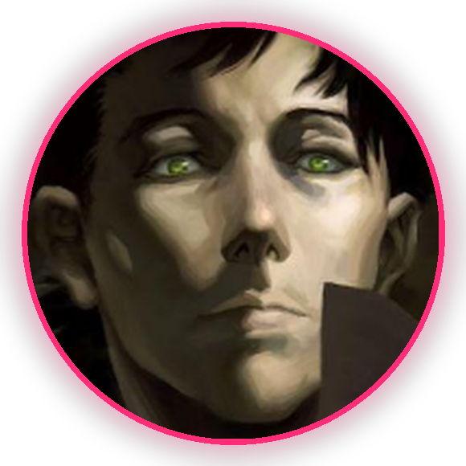
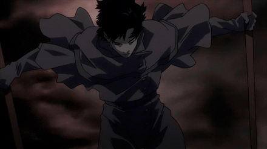

# ❤️ Hi, I'm loveqcn

*The Discord card above is **live** — come say hi, i'm **loveqcn**.*

---

## 🛠️ What I'm building

| | Project | What it does |
|---|---|---|
| ❤️ | **[aram-love-bot](https://github.com/vincntlaw/aram-love-bot)** | League of Legends ARAM companion — finds friends in live games and chats like your duo, powered by a local LLM |
| 🔬 | **[Principia](https://github.com/vincntlaw/Principia)** | My restyled fork of the living Principles Cloud for autonomous scientific discovery |

## 📊 GitHub Stats

<!-- Kendi github-readme-stats instance'in kurunca bu blogu ac
(public instance anlik pause durumunda, bu yuzden kapali):

-->

## 🧰 Toolbox

`local LLM wrangling` · `League Client (LCU) automation` · `Reverse-engineering APIs` · `Discord ecosystem` · `Windows PowerShell wizardry`

## 🎮 Off-keyboard

- ⚔️ ARAM enjoyer — Howling Abyss is home
- 🐉 Local LLM tinkerer — my models run on my own machine
- 🐧 Poro rights activist

**[💬 Discord](https://discord.com/users/283333002749018113)** · **[📦 aram-love-bot](https://github.com/vincntlaw/aram-love-bot)** · made with ❤️

